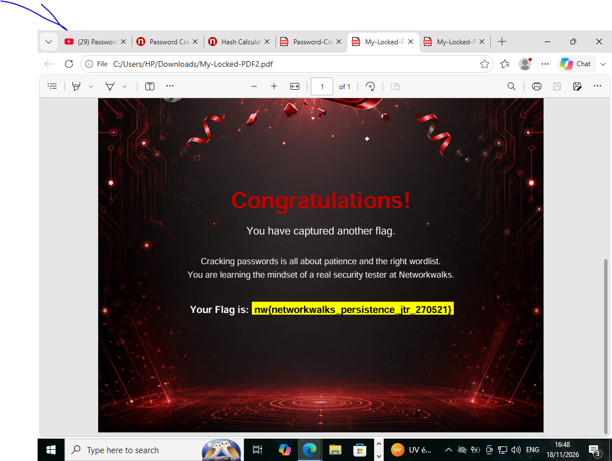

# Networkwalks-week-3-hash-calculator-

# NetworkWalks – Week 3 (W3-PM2): PDF Password Hash Extraction & Recovery

## 📌 Overview
This repository documents **W3-PM2**, a hands-on exercise completed during the
**NetworkWalks** cybersecurity internship program (Week 3). The exercise focused on
password hashing and password recovery concepts, performed entirely on a mobile
device (Windows-track exercise, done via mobile apps).

> ⚠️ **Scope note:** This was a controlled, authorised training exercise provided
> by NetworkWalks. No real, third-party, or production systems were targeted.
> Screenshots and notes here are for personal learning documentation only.

## 🧰 Tools Used

| Tool | Purpose |
|---|---|
| **NetworkWalks Hash Calculator** | Extracts the password hash from a protected PDF file |
| **NetworkWalks Password Cracker** | Performs dictionary-based password recovery against the extracted hash |

## 🪜 Steps Performed

1. **Hash extraction**
   - Opened the protected PDF in the NetworkWalks Hash Calculator app.
   - Extracted the password hash associated with the PDF's encryption.

2. **Password recovery**
   - Loaded the extracted hash into the NetworkWalks Password Cracker.
   - Ran a **dictionary-based attack** (wordlist comparison) against the hash.
   - Recovered the original password once a match was found in the wordlist.

```text
[PDF file] --(Hash Calculator)--> [password hash]
[password hash] --(Password Cracker + dictionary)--> [recovered password]
```

## 🎯 Key Takeaways

- A password hash is only as strong as the password behind it — weak or common
  passwords fall quickly to a dictionary attack.
- Long, unique passwords make recovery significantly harder and slower.
- Salting and strong hashing algorithms (e.g. bcrypt, Argon2) add protection
  that a simple hash calculator/cracker pair cannot defeat as easily.
- These concepts apply directly to real-world document and account security —
  always use strong passwords to protect sensitive files.
  

## 📂 Repository Structure

```text
networkwalks-w3-pm2/
├── README.md          # This file
├── notes/              # Personal write-up / lab notes
└── screenshots/        # Evidence of completed steps (hash extracted, password recovered)


## 🔗 Related

- NetworkWalks Internship Program – Week 3
- LinkedIn post: *NetworkWalks, Week 3 (W3-PM2): extracting and cracking a PDF password hash*

---
**Author:** Younoussa Gassama
**Program:** NetworkWalks Cybersecurity Internship — Week 3
